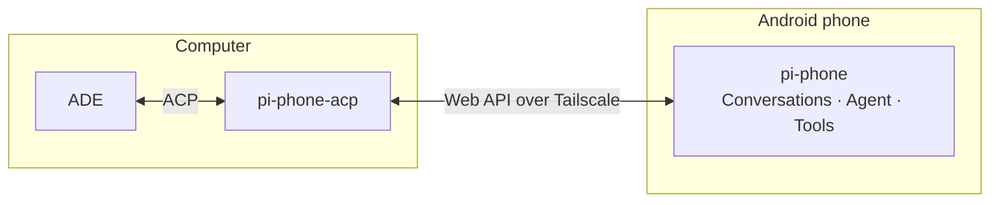

# pi-phone-acp

ACP adapter making [pi-phone](https://github.com/picassio/pi-phone) available to [ADE](# "Agentic Development Environment")s such as T3 Code, Herdr, Orca, Zed...

This allows to **control a pi agent on an android phone** directly from computer **in the ADE**, like any other agent.

## How it works

### Architecture



pi-phone manages the conversations, the agent and its tools. pi-phone-acp is just a way to display those conversations and interact with the agent remotely from an ADE.

Therefore disconnecting the ADE does not stop the agent.

### Remote access

It reuses the API of the remote browser interface (web UI) that comes with pi-phone. **No `adb`**, **wireless debugging**, phone SSH server, etc...

Both the computer running the ADE and the android phone must be on the **same Tailscale network**.

## Features

- **Action Approvals<sup>[1]</sup> :** Allow or deny phone action requests directly from the ADE.
- **Extension questions:** Answer questions and text-entry forms from pi-phone extensions.
- **Interviews:** Complete text and choice questionnaires, with multiple selections, notes, optional questions and final confirmation.
- **Rich context:** View code snippets, formatted Markdown, tables and option descriptions alongside questions.
- **Markdown source:** Display literal when requested (such as `**bold**` instead of rendered formatting).
- **Secrets input<sup>[2]</sup>:** Enter passwords and security codes in **masked prompts** for the following requests:
    - [x] Secret storage — prompts to save a secret in pi-phone Settings → Secrets.
    - [x] Browser sign-in — prompts to fill username/password fields in pi-phone's browser.
    - [x] Browser security code — prompts to fill a security-code field in pi-phone's browser.
    - [x] Desktop app sign-in — prompts to fill sign-in fields in a desktop app via remote computer control. [live test failed]
    - [ ] Chrome Remote Desktop setup — prompts for Google’s connection command and remote-access PIN.
    - [ ] Extension Forms secret fields — prompts from extensions for fields with `secret: true`.
    - [ ] Credential prompts within interviews.
    > Unchecked items are not yet forwarded, even as regular prompts. These requests must be answered on the phone.
- **Rich-content fallback:** Forms containing images, interactive previews or other unsupported content stay on the phone, with a notice in the ADE rather than an incomplete form.

_[1] Requires permission mode to be set to "Supervised" in ADE, othwerise "Full access" can auto approve them.<br/>In any case pi-phone still decides which actions require approval._<br/>
_[2] T3 Code only._

Targets the pi-phone **build-508** interface (`c59e0ceb993dc0ded331eeb6758f86bbaed75cec`); used with **T3 Code 0.1.8** (ACP v1).

## Build and configure

Node.js 22 or later on Linux or macOS is required. Build on the machine that will run the adapter.

```sh
npm ci --ignore-scripts
npm run build
```

| Environment variable | Value |
| --- | --- |
| `PI_PHONE_URL` | Explicit service origin, such as `http://PHONE:8787`. No sign-in token, path or query string. |
| `PI_PHONE_TOKEN_FILE` | Absolute path to an owned, private regular file outside the repository containing only the device-session token. Owner-only permissions such as `0600` are required. Symlinks are refused. |
| `PI_PHONE_CWD` | Existing local folder inside pi-phone, default `~/work`. This is not T3's project directory. |
| `PI_PHONE_SECRET_FILES_DIR` | Optional exact canonical T3 secret-delivery directory, default `~/.t3/userdata/secrets/files`. Set explicitly for custom T3 server layouts. Private forwarding currently requires Linux. |

Use a separately provisioned pi-phone device-session token from the existing sign-in flow. The adapter sends it as a Bearer token with `X-Pocket: 1`. It does not perform sign-in, store cookies, alter networking or manage provider credentials. Keep the token out of command arguments, Git, notes and `codesync/`. Only send plain HTTP through an already authorized, encrypted Tailscale connection.

```sh
node dist/cli.js --doctor
node dist/cli.js
```

`--doctor` performs an authenticated read of `/api/me`. A successful response establishes reachability and a compatible response shape, **not** the installed APK hash or running runtime version. Normal execution reserves stdout for newline-delimited ACP JSON. Diagnostics go to stderr without raw request or response details.

After separately approving provider setup, T3 can use a **Local ACP command** with the absolute Node executable and the absolute `dist/cli.js` path as its argument. Set the environment variables on that same T3 server. Building the adapter does not install or register a provider.

## Behavior

- Reconnecting restores the phone conversation and observes existing work without restarting it or sending another prompt.
- Submissions are never retried automatically, so inspect the phone conversation and reload it before retrying an uncertain result.
- Stop affects the whole phone conversation, including queued messages, rather than just the current input request. T3 specific?
- Secret-store prompts values are saved in pi-phone Settings > Secrets. This is not the case for browser sign-in prompts which only fill corresponding fields. 
- Declining a private prompt rejects only its matching phone request, while cancellation, timeout and disconnect leave it unanswered.

## Limits

- The phone's model, instructions and tool permissions apply, and the ADE's local sandbox does not restrict phone tools.
- Prompts support text only, and responses appear message by message rather than token by token.
- Messages sent to the same phone conversation from another client can make the ADE turn fail because the adapter cannot reliably identify which response belongs to it.
- After an adapter disconnection, questions still waiting on the phone must be completed there, whether they appeared in the ADE earlier or were asked while disconnected.
- Forms with partially completed answers saved on the phone (entered text or selected choices), or with saved sign-in choices, must be completed through the phone's interface.

### T3 Code specific

- T3 stores ordinary form answers in history and trims outer whitespace from both ordinary and private input.
- Interrupted secret-file delivery can leave a temporary file for T3's existing cleanup.
- T3 Masked input is used (among other requests) for A. requests to fill secret fields in Extension Forms and B. credential prompts within interviews but this can give a misleading impression of protection since for A. nothing guarantes that the extension handle those safely and B. the interview "answer" (all the values user has chosen) is sent back to the LLM in plain sight.


## Development checks

```sh
npm run check
npm test
npm audit --omit=dev
```
