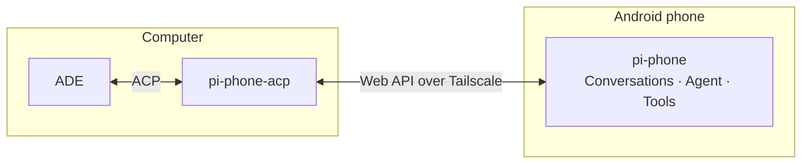

# pi-phone-acp

ACP adapter making [pi-phone](https://github.com/picassio/pi-phone) available to [ADE](# "Agentic Development Environment")s such as T3 Code, Herdr, Orca, Zed...

This allows to **control a pi agent on an android phone** directly from computer **in the ADE**, like any other agent.

## How it works

### Architecture



pi-phone manages the conversations, the agent and its tools. pi-phone-acp is just a way to display those conversations and interact with the agent remotely from an ADE.

Therefore disconnecting the ADE does not stop the agent.

### Remote access

It reuses the API of the remote browser interface (web UI) that comes with pi-phone. **No `adb`**, **wireless debugging**, phone SSH server, etc...

Both the computer running the ADE and the android phone must be on the **same Tailscale network**.

## Features

- **Approvals:** Allow or deny phone action requests directly from the ADE.
- **Extension questions:** Answer questions and text-entry forms from phone extensions.
- **Interviews:** Complete text and choice questionnaires, with multiple selections, notes, optional questions and final confirmation.
- **Rich context:** View code snippets, formatted Markdown, tables and option descriptions alongside questions.
- **Markdown source:** Display literal when requested (such as `**bold**` instead of rendered formatting).
- **Secrets input:** Enter passwords and security codes in masked prompts for secret requests and browser or computer sign-in.
- **Rich-content fallback:** Forms containing images, interactive previews or other unsupported content stay on the phone, with a notice in the ADE rather than an incomplete form.

Targets the pi-phone **build-508** interface (`c59e0ceb993dc0ded331eeb6758f86bbaed75cec`); used with **T3 Code 0.1.8** (ACP v1).

## Build and configure

Node.js 22 or later on Linux or macOS is required. Build on the machine that will run the adapter.

```sh
npm ci --ignore-scripts
npm run build
```

| Environment variable | Value |
| --- | --- |
| `PI_PHONE_URL` | Explicit service origin, such as `http://PHONE:8787`. No sign-in token, path or query string. |
| `PI_PHONE_TOKEN_FILE` | Absolute path to an owned, private regular file outside the repository containing only the device-session token. Owner-only permissions such as `0600` are required. Symlinks are refused. |
| `PI_PHONE_CWD` | Existing local folder inside pi-phone, default `~/work`. This is not T3's project directory. |
| `PI_PHONE_SECRET_FILES_DIR` | Optional exact canonical T3 secret-delivery directory, default `~/.t3/userdata/secrets/files`. Set explicitly for custom T3 server layouts. Private forwarding currently requires Linux. |

Use a separately provisioned pi-phone device-session token from the existing sign-in flow. The adapter sends it as a Bearer token with `X-Pocket: 1`. It does not perform sign-in, store cookies, alter networking or manage provider credentials. Keep the token out of command arguments, Git, notes and `codesync/`. Only send plain HTTP through an already authorized, encrypted Tailscale connection.

```sh
node dist/cli.js --doctor
node dist/cli.js
```

`--doctor` performs an authenticated read of `/api/me`. A successful response establishes reachability and a compatible response shape, **not** the installed APK hash or running runtime version. Normal execution reserves stdout for newline-delimited ACP JSON. Diagnostics go to stderr without raw request or response details.

After separately approving provider setup, T3 can use a **Local ACP command** with the absolute Node executable and the absolute `dist/cli.js` path as its argument. Set the environment variables on that same T3 server. Building the adapter does not install or register a provider.

## Behavior and limits

T3 negotiates ACP v1. New ACP sessions create native phone conversations. T3 can reload those same native IDs after reconnecting. Reloading replays saved history and resumes observation of existing work without sending a replacement prompt. There is no local conversation database, automatic task restart, native-session listing or model switching. The phone's configured model and instructions apply.

The adapter uses authenticated long polling with acknowledged sequence numbers. If a poll session expires, it reads a fresh snapshot and fills history gaps without replaying committed output twice. Text and thoughts appear at committed message boundaries, not token by token. Tool progress and output update while work runs. Incoming ACP prompts currently support text only.

A lost submission response is an unknown outcome, not permission to retry. The adapter never retries session creation or submission automatically. After an uncertain turn it refuses another submission until the conversation is explicitly reloaded. Inspect the phone history before retrying. Do not write to the same conversation from another client during an ACP prompt. Build 508 does not expose a submission-to-transcript mapping, so detected concurrent human writers cause an error rather than a guessed success.

Only an explicit ACP cancellation invokes pi-phone's Stop action. **Stop is conversation-wide and also withdraws queued messages.** Transport loss, stdin EOF, process signals and approval-dialog cancellation do not invoke Stop. The phone and Android still control background survival. The adapter cannot make an Android-killed task resume exactly once.

Simple phone approvals, including native risky-action cards, become T3 allow-once/deny-once questions with the action and location shown. T3's permission mode may answer those questions automatically. Supported non-sensitive ask forms and text/choice interviews use structured ACP elicitation during an active T3 turn, never permission buttons. Interviews support code and portable Markdown context, Other, choice notes, explicit Skip and final Submit; defaults are described, not selected automatically. T3 trims outer whitespace and stores ordinary answers in history.

Dedicated phone secret requests and browser/computer sign-in/code cards can use T3 0.1.8 password cards during an active turn. T3 writes a private file on its server; the adapter validates, reads and removes it, collects all fields, then submits once to the matching phone endpoint. Values stay out of ordinary form answers and adapter updates. Sign-in values are not saved in phone Secrets; existing saved sign-in choices stay on the phone. Secret-store cards explicitly save in phone Settings > Secrets. T3 trims outer whitespace, and a lost file-delivery response can leave an upstream file for T3's existing cleanup. See the [private-input audit](docs/private-input-audit.md) for scope and limits.

Sensitive generic asks/interviews, media/image/interactive-HTML interviews and existing phone drafts remain phone-only. Reconnect replay never opens forms outside an active turn. Ordinary protocol Decline refuses an ask or skips an interview. Private-card Decline rejects only the matching phone request without sending values, so the waiting call can finish; cancel, timeout and disconnect leave it unanswered. T3 0.1.8 has no form-only Cancel control for ordinary forms: final `false` leaves an interview on the phone, while global Stop can stop phone work. Disconnect never invents an answer. See [interactive prompt mapping](docs/interactive-prompts.md).

The adapter does not impose a T3 sandbox on phone tools. The reported phone grants pi-phone app-wide KernelSU root access, so authenticated remote execution must be treated accordingly.

T3's file, terminal, Git and checkpoint panels remain on the T3 host. The adapter uses only the advertised `t3-code` MCP helper for private input; it does not execute other client MCP servers or forward them to Android. Configure phone tools on the phone. Additional client workspace roots and client system prompts are refused rather than silently treated as phone configuration.

## Development checks

```sh
npm run check
npm test
npm audit --omit=dev
```

Tests cover submission uncertainty, cancellation, disconnects, process replacement, poll replay/expiry, compaction history, native approvals, structured form answers, unsupported/private input safeguards, credential files and stdout isolation. Automated checks do not establish live interactive rendering or the installed phone runtime version.
